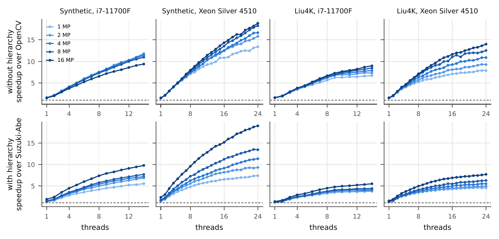
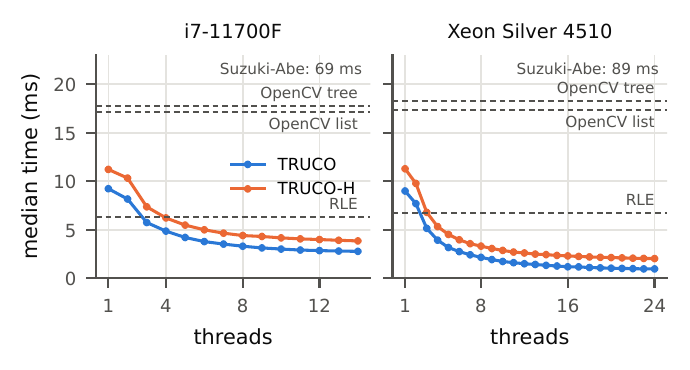

# TRUCO: Deterministic and Data-Race-Free Parallel Contour Tracing


**TRUCO** (Threaded Raster Unrestricted Contour Ownership) is a header-only parallel contour-tracing algorithm for
multi-core CPUs. It returns **exactly the output of the Suzuki–Abe algorithm** (`cv::findContours` with
`CHAIN_APPROX_NONE`): the same contours, in the same order, with the same hierarchy, in the modes `RETR_LIST`,
`RETR_CCOMP` and `RETR_TREE`. It uses no locks, no read-modify-write operations and no stitching phase, and
its output does not depend on the number of threads or on their scheduling.

📄 **Paper:** [TRUCO: Deterministic and Data-Race-Free Parallel Contour Tracing through Geometric Contour Ownership](https://drive.google.com/file/d/1VsIpt6wwQVYd-19eRT542GAbkzSrwQAZ/view?usp=drive_link) (preprint)

## How it works

The image is split into horizontal stripes, one per thread. Each thread scans its stripe and traces complete
contours, following them freely into the stripes below. Two rules make the threads independent:

* **Row-local writes:** a thread writes marks only on its own rows (and on a private copy of the first row of the
  next stripe), so every decision of a thread depends only on the input image and on its own writes.
* **Geometric contour ownership:** each contour is accepted only by the thread whose rows contain its topmost
  row (outer contours) or the row below it (holes); a trace that moves above its stripe is aborted.

The hierarchy is recovered afterwards from one reference per contour, a neighbouring border found on the row
where the contour starts, so the threads share a one-byte label image and never need the contour numbers of
the other stripes. The paper proves that the output is deterministic and identical to that of Suzuki–Abe, and
that the algorithm is free of data races under the C++ memory model (cross-thread accesses use relaxed
`std::atomic_ref` byte loads and stores, which compile to plain moves).

## Performance

Measured on an Intel Core i7-11700F (14 threads) and an Intel Xeon Silver 4510 (24 threads of one NUMA node),
on synthetic images, high-resolution photographs (Liu4K, 1–16 MP) and building segmentation masks (Inria, 25 MP).
At the largest resolution of each dataset:

* **With the hierarchy**, TRUCO is **4.7 to 17.4 times faster** than the fastest sequential method that computes
  it (Suzuki–Abe or OpenCV `RETR_TREE`).
* **Without the hierarchy**, it is **2.3 to 17.8 times faster** than the fastest of OpenCV `RETR_LIST` and the
  run-based `cv::findContoursLinkRuns`.
* **With a single thread**, TRUCO already computes the full hierarchy 1.2 to 7.7 times faster than Suzuki–Abe.
* On inputs designed to defeat the stripe decomposition, its time does not grow with the number of threads.

| Speedup vs. threads (synthetic and Liu4K) | Inria masks, 25 MP |
| :---: | :---: |
|  |  |

## Usage

TRUCO is a single header, `findtrucontour.h`: copy it into your project and include it. It needs a C++20 compiler
and OpenCV 4.x. The number of threads is the one of OpenCV (`cv::setNumThreads`).

```cpp
#include "findtrucontour.h"
#include <opencv2/imgcodecs.hpp>

int main() {
    cv::Mat img = cv::imread("mask.png", cv::IMREAD_GRAYSCALE);     // binary image, CV_8UC1 (0 / 255)

    // Contours with hierarchy: identical to
    // cv::findContours(img, contours, hierarchy, cv::RETR_TREE, cv::CHAIN_APPROX_NONE)
    std::vector<std::vector<cv::Point>> contours;
    std::vector<cv::Vec4i> hierarchy;
    cv::findTRUContours(img, contours, hierarchy, cv::RETR_TREE);

    // Contours only (faster; the order is not the one of cv::findContours)
    std::vector<std::vector<cv::Point>> flat;
    cv::findTRUContours(img, flat);
}
```

Optional arguments: `mode` (`RETR_LIST`, `RETR_CCOMP`, `RETR_TREE`), `minSize` (contours with fewer points are
not returned) and `binarize` (treat any non-zero pixel as foreground; otherwise the image must be 0 / 255).

## Citation

```bibtex
@article{truco2026,
  title={TRUCO: Deterministic and Data-Race-Free Parallel Contour Tracing through Geometric Contour Ownership},
  author={Mu{\~n}oz-Salinas, Rafael and Romero-Ramirez, Francisco J. and Mar{\'i}n-Jim{\'e}nez, Manuel J.},
  journal={To be published},
  year={2026}
}
```

## Authors

* Rafael Muñoz-Salinas, University of Córdoba
* Francisco J. Romero-Ramirez, University of Córdoba
* Manuel J. Marín-Jiménez, University of Córdoba
